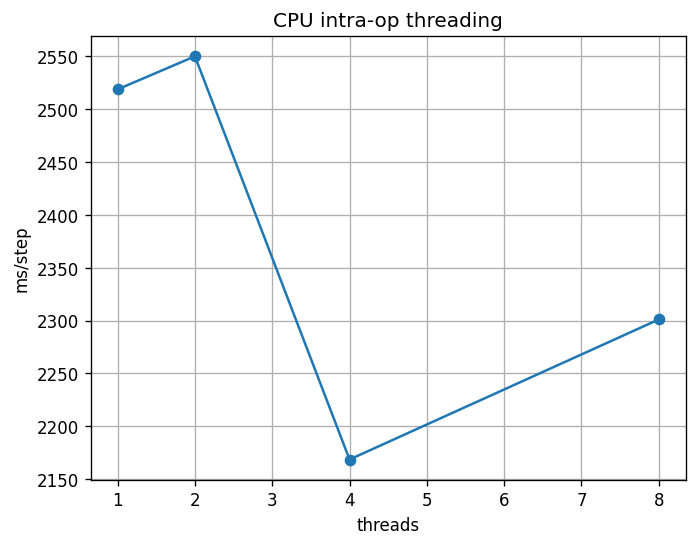

# Phase 2 — Reflection: where does parallelism stop helping?

Copy this file to `submission/phase2_reflection.md`, fill in every answer slot, and commit it:

```bash
cp phase-2-tiny-gpt/reflection_template.md submission/phase2_reflection.md
```

**How to fill it in.** Each answer sits between a pair of `<!--answer:...-->` markers. Replace
the `TODO` line with your answer — **leave the markers themselves untouched**, they are how the
grader finds your answers. Anything you write outside the markers is ignored, so add extra
prose, tables or your threading plot freely.

Numbers in section 1 must **match `submission/phase2_report.json`** — copy them across, do not
retype from memory; they are checked against it.

---

## 1. Your measurements

| | Value |
|---|---|
| Naive attention, ms (`attention.naive_ms`) | <!--answer:attn_naive_ms-->384.349<!--/answer--> |
| Vectorized attention, ms (`attention.vectorized_ms`) | <!--answer:attn_vectorized_ms-->1.106<!--/answer--> |
| CPU training, ms for 100 steps (`devices.cpu_ms`) | <!--answer:cpu_ms-->434740.2<!--/answer--> |
| GPU training, ms for 100 steps (`devices.gpu_ms`) | <!--answer:gpu_ms-->14039.8<!--/answer--> |
| Final training loss (`training.final_loss`) | <!--answer:final_loss-->1.4862<!--/answer--> |

**The thread sweep.** Give your four timings from `threads` — 1, 2, 4 and 8 threads — and say
which count was fastest. (verbatim: the numbers, in order)

<!--answer:thread_sweep-->
1 thread: 2518.842 ms, 2 threads: 2550.128 ms, 4 threads: 2168.41 ms, 8 threads: 2300.994 ms. Fastest: 4 threads (2168.41 ms per step).
<!--/answer-->



---

## 2. Intra-node parallelism, three ways

**Why vectorizing wins.** Both attention implementations do the same arithmetic and produce the
same result (the unit test checks that). Explain where the naive version's time actually goes,
and what the vectorized one does differently — in terms of the machine, not the Python.
(~70 words)

<!--answer:vectorization_why-->
The naive version spends almost all of its 384.349 ms in the Python interpreter, not in arithmetic: every one of the T×T = 65,536 dot products is a separate loop iteration with bytecode dispatch, boxed floats, bounds checks and a small NumPy call. The vectorized version issues a few whole-matrix operations (Q·Kᵀ, softmax, ·V) that run in compiled OpenBLAS. That code streams contiguous memory through the caches and uses AVX2/AVX-512 SIMD registers (X86_V3/V4 found by `np.show_config()`), processing several floats per instruction with fused multiply-adds. Result: 1.106 ms, a 347.5x speedup for the same maths.
<!--/answer-->

**Where the thread curve flattens, and why.** Using your sweep: more threads stopped helping —
or started hurting — at some point. Say where, and give the reason. Your Colab runtime's vCPU
count is part of the answer; so is what the threads have to coordinate on. (~80 words)

<!--answer:threading_plateau-->
The curve is almost flat. 1 → 2 threads did not help at all (2518.842 → 2550.128 ms), 4 threads was only 14% faster (2168.41 ms), and 8 threads got worse again (2300.994 ms). Colab's runtime has only 2 vCPUs, which are two hyperthreads that share one physical core's execution units and caches. So there is very little real hardware to spread the work across, and beyond 2 threads the threads are oversubscribed: the OS time-slices them, and PyTorch pays to split every op, synchronise at a barrier after each op and merge results. For this small model (block 256, batch 16) each matmul is too small for that overhead to be amortised. With only 3 repeats per point, the small gain at 4 is within the noise of a shared VM.
<!--/answer-->

**What made the GPU faster.** The model, the data and the step count were identical; only the
device changed. Say what about a transformer training step suits a GPU, and name one workload
that would *not* see this speed-up. (~70 words)

<!--answer:gpu_why-->
A transformer training step is dominated by large dense matrix multiplies (QKV and output projections, the attention scores, the MLP) over a whole batch at once. These are independent multiply-adds with regular memory access: exactly what the T4's ~2,560 CUDA cores and high-bandwidth GDDR6 are built for. The same 100 steps took 14039.8 ms on the GPU against 434740.2 ms on the CPU (31x). A workload that would not benefit: sequential, branchy, low-arithmetic work such as autoregressive sampling of one token at a time with batch size 1, or our echo bot from Phase 1, where per-launch and host-to-device copy overheads dominate.
<!--/answer-->

---

## 3. The question

**Where does parallelism stop helping, and why?** Pull the three experiments together. Your
answer should distinguish the *kinds* of limit you met — work that cannot be divided, hardware
you do not have, coordination that costs more than it saves, data that has to move — and say
which one bound each experiment. One concrete number from section 1 per claim. (~150 words)

<!--answer:parallelism_limit-->
Parallelism stops helping when something other than arithmetic becomes the bottleneck, and each experiment hit a different limit.

- **Vectorization** was limited only by overhead that could be removed: the naive loop was interpreter-bound, not compute-bound. Moving the work into SIMD BLAS gave 384.349 → 1.106 ms (347.5x), so here parallelism helped enormously.
- **Threads** hit *hardware I do not have* plus *coordination that costs more than it saves*. With 2 vCPUs on one physical core, going from 1 to 2 threads gave nothing (2518.842 → 2550.128 ms), and 8 threads (2300.994 ms) was slower than 4 (2168.41 ms) because oversubscribed threads only add scheduling and synchronisation cost.
- **GPU** helped most for whole training steps (434740.2 → 14039.8 ms, 31x), but it is bounded by *data that has to move* and *work that cannot be divided*. Batches are copied host-to-device every step, and the layers must run in order, with each step depending on the previous update. That is why a 2,560-core GPU gives 31x and not 1000x.

Training still converged to a final loss of 1.4862.
<!--/answer-->

**What you would measure next.** One experiment this phase did not run that would sharpen the
answer, and what result would change your mind. (~50 words)

<!--answer:next_experiment-->
Re-run the thread sweep on a machine with 8+ physical cores (or a high-CPU Colab runtime), with more repeats and a larger batch. If time per step kept falling up to the physical core count, the plateau here was caused by having 2 vCPUs, not by synchronisation overhead; if it still flattened at 2–4 threads, coordination is the real limit.
<!--/answer-->
